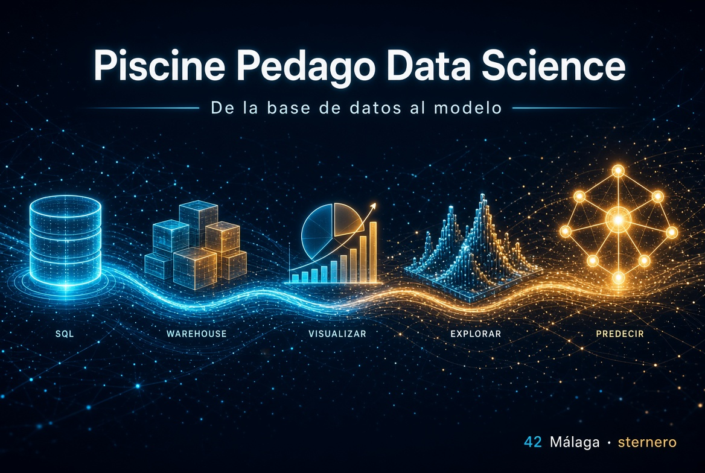

<p align="center">
  
</p>

<div align="center">

[](https://www.42malaga.com/)
[](https://www.w3schools.com/datascience/)
[](https://www.postgresql.org/docs/current/tutorial-sql.html)
[](https://www.postgresql.org/)
[](https://www.docker.com/)
[](https://www.python.org/)
[](https://pandas.pydata.org/)
[](https://matplotlib.org/)
[](https://scikit-learn.org/)
[](#-módulos)

**42 Málaga** · sternero · Formación práctica en datos: de la base SQL al modelo que predice

[Índice](#indice) · [Módulos](#-módulos) · [Vídeos formativos](#videos-formativos) · [Clonar](#-cómo-clonar)

</div>

---

<a id="indice"></a>

## 📑 Índice

1. [Qué es esta piscine](#-qué-es-esta-piscine)
2. [Módulos](#-módulos)
3. [Flujo didáctico](#-flujo-didáctico)
4. [Material didáctico](#-material-didáctico)
5. [Vídeos formativos en español](#videos-formativos)
   - [5.1 — M0: SQL, PostgreSQL y Docker](#videos-m0)
   - [5.2 — M1: Data Warehouse y ETL](#videos-m1)
   - [5.3 — M2: Visualización de datos](#videos-m2)
   - [5.4 — M3: Estadística y EDA](#videos-m3)
   - [5.5 — M4: Machine Learning](#videos-m4)
6. [Cómo clonar](#-cómo-clonar)
7. [Estructura](#-estructura)
8. [Requisitos habituales](#-requisitos-habituales)
9. [Enlaces](#-enlaces)

---

## 🎯 Qué es esta piscine

Recorrido **guiado** (pedago) por el oficio del dato:

| Fase | Qué aprendes |
|------|----------------|
| **Crear** | Bases PostgreSQL, Docker, tablas desde CSV |
| **Almacenar** | Warehouse, limpieza, unificación |
| **Visualizar** | Gráficos y lectura de distribuciones |
| **Explorar el presente** | Histogramas, correlación, escalas, split |
| **Predecir el futuro** | Métricas, features, árboles, KNN, voting |

Cada módulo es un **submódulo Git** con su propio README, guías (`python.md`, etc.) y scripts.

---

## 📚 Módulos

| # | Carpeta / repo | Tema | Estado |
|---|----------------|------|--------|
| **0** | [`data_science_0_creation_db`](https://github.com/STC71/42_data_science_0_creation_db) | Creation of a DB (PostgreSQL, Docker, CSV → tablas) | ✅ |
| **1** | [`data_science_1_data_warehouse`](https://github.com/STC71/42_data_science_1_data_warehouse) | Data Warehouse | ✅ |
| **2** | [`data_science_2_data_viz`](https://github.com/STC71/42_data_science_2_data_viz) | Data visualization | ✅ |
| **3** | [`data_science_3_the_present`](https://github.com/STC71/42_data_science_3_the_present) | The present (EDA, escalas, split) | ✅ |
| **4** | [`data_science_4_the_future`](https://github.com/STC71/42_data_science_4_the_future) | The future (clasificación Jedi/Sith) | ✅ |

[↑ Volver al índice](#indice)

---

## 🔄 Flujo didáctico

```text
M0  SQL + Docker          →  tener datos estructurados
M1  Warehouse             →  limpiar y consolidar
M2  Visualización         →  ver patrones
M3  The present           →  estadísticas, correlaciones, train/val
M4  The future            →  modelos y predicción
```

En M4 se reutilizan `Training_knight.csv` / `Validation_knight.csv` del M3.

---

## 📐 Material didáctico

Además del `README.md` y de las guías de cada ejercicio (`ex0N/python.md`, etc.),
cada módulo acumula documentación **didáctica de apoyo** (no sustituye al subject
ni a los entregables).

### Matemáticas (`mates.md`)

Los módulos 2, 3 y 4 incluyen un `mates.md` con fórmulas, analogías y ejemplos:

| Módulo | Material |
|--------|----------|
| **2** | [Matemáticas de Data Viz](./data_science_2_data_viz/mates.md) |
| **3** | [Matemáticas de The present](./data_science_3_the_present/mates.md) |
| **4** | [Matemáticas de The future](./data_science_4_the_future/mates.md) |

Los módulos 0 y 1 no tienen actualmente un `mates.md` independiente; sus
explicaciones están integradas en los README y guías de SQL, Docker y warehouse.

### Guías de herramientas (raíz de cada módulo)

Documentación **desde cero** (Python, tablas, gráficos, modelos, SQL del warehouse),
pensada también como carta de presentación en procesos selectivos:

| Módulo | Guías en la raíz del módulo |
|--------|-----------------------------|
| **2** Data Viz | [python.md](./data_science_2_data_viz/python.md) · [numpy.md](./data_science_2_data_viz/numpy.md) · [matplotlib.md](./data_science_2_data_viz/matplotlib.md) · [scikit-learn.md](./data_science_2_data_viz/scikit-learn.md) · [sql-data-warehouse.md](./data_science_2_data_viz/sql-data-warehouse.md) · [mates.md](./data_science_2_data_viz/mates.md) |
| **3** The present | [python.md](./data_science_3_the_present/python.md) · [pandas.md](./data_science_3_the_present/pandas.md) · [numpy.md](./data_science_3_the_present/numpy.md) · [matplotlib.md](./data_science_3_the_present/matplotlib.md) · [mates.md](./data_science_3_the_present/mates.md) |
| **4** The future | [python.md](./data_science_4_the_future/python.md) · [pandas.md](./data_science_4_the_future/pandas.md) · [numpy.md](./data_science_4_the_future/numpy.md) · [matplotlib.md](./data_science_4_the_future/matplotlib.md) · [scikit-learn.md](./data_science_4_the_future/scikit-learn.md) · [mates.md](./data_science_4_the_future/mates.md) |

| Guía | Para qué sirve (idea) |
|------|------------------------|
| `python.md` | Hub del lenguaje y mapa de ejercicios del módulo |
| `pandas.md` | CSV, DataFrame, Train/Test, `X`/`y` (central en M3–M4) |
| `numpy.md` | Arrays, `shape`, estadísticas en bloque |
| `matplotlib.md` | Tipos de gráfico del módulo y PNG en 42 |
| `scikit-learn.md` | Scaler, K-Means (M2) / Tree·KNN·Voting (M4) |
| `sql-data-warehouse.md` | SQL y conexión al warehouse (M2) |
| `mates.md` | Cuentas y fórmulas con analogías |

### Defensa guiada (`evaluation.sh`)

Varios módulos incluyen un `evaluation.sh` en la **raíz** (guía interactiva alineada
con la hoja de evaluación). **No** forma parte de la nota ni sustituye la defensa oficial:

| Módulo | Script |
|--------|--------|
| **2** | [`evaluation.sh`](./data_science_2_data_viz/evaluation.sh) |
| **3** | [`evaluation.sh`](./data_science_3_the_present/evaluation.sh) |
| **4** | [`evaluation.sh`](./data_science_4_the_future/evaluation.sh) |

(El módulo 0 puede disponer de evaluación guiada en su propio repo; consulta su README.)

[↑ Volver al índice](#indice)

---

<a id="videos-formativos"></a>

## 🎬 Vídeos formativos en español

Esta selección sigue el orden de la piscine: conviene completar cada bloque antes
de pasar al siguiente. Los enlaces abren búsquedas temáticas de YouTube en español
para que sigan siendo útiles aunque un vídeo concreto sea retirado o sustituido.
Prioriza vídeos con ejemplos ejecutables, código visible y explicación de por qué
se hace cada paso; los vídeos complementan, pero no sustituyen, el subject ni la
documentación de cada módulo.

<a id="videos-m0"></a>

### 5.1 M0 – SQL, PostgreSQL y Docker

- [SQL desde cero: SELECT, filtros, JOIN y GROUP BY](https://www.youtube.com/results?search_query=SQL+desde+cero+espa%C3%B1ol+SELECT+JOIN+GROUP+BY)
- [PostgreSQL desde cero: instalación, tablas y consultas](https://www.youtube.com/results?search_query=PostgreSQL+desde+cero+espa%C3%B1ol+tablas+consultas)
- [Claves primarias, foráneas y relaciones SQL](https://www.youtube.com/results?search_query=claves+primarias+for%C3%A1neas+relaciones+SQL+espa%C3%B1ol)
- [Docker desde cero: imágenes, contenedores y volúmenes](https://www.youtube.com/results?search_query=Docker+desde+cero+espa%C3%B1ol+im%C3%A1genes+contenedores+vol%C3%BAmenes)

[↑ Volver al índice](#indice)

<a id="videos-m1"></a>

### 5.2 M1 – Data Warehouse y ETL

- [Data Warehouse: hechos y dimensiones](https://www.youtube.com/results?search_query=data+warehouse+hechos+dimensiones+espa%C3%B1ol)
- [ETL y ELT: extracción, transformación y carga](https://www.youtube.com/results?search_query=ETL+ELT+extracci%C3%B3n+transformaci%C3%B3n+carga+espa%C3%B1ol)
- [Limpieza y transformación de datos con SQL](https://www.youtube.com/results?search_query=limpieza+transformaci%C3%B3n+datos+SQL+espa%C3%B1ol)
- [Modelado dimensional y normalización](https://www.youtube.com/results?search_query=modelado+dimensional+normalizaci%C3%B3n+data+warehouse+espa%C3%B1ol)

[↑ Volver al índice](#indice)

<a id="videos-m2"></a>

### 5.3 M2 – Visualización de datos

- [Python y pandas desde cero para análisis de datos](https://www.youtube.com/results?search_query=Python+pandas+desde+cero+an%C3%A1lisis+datos+espa%C3%B1ol)
- [Matplotlib desde cero: gráficos en Python](https://www.youtube.com/results?search_query=Matplotlib+desde+cero+Python+espa%C3%B1ol)
- [Histogramas, boxplots y distribuciones](https://www.youtube.com/results?search_query=histogramas+boxplots+distribuciones+estad%C3%ADstica+espa%C3%B1ol)
- [K-Means y método del codo](https://www.youtube.com/results?search_query=K-Means+m%C3%A9todo+del+codo+clustering+espa%C3%B1ol)

[↑ Volver al índice](#indice)

<a id="videos-m3"></a>

### 5.4 M3 – Estadística y EDA

- [Análisis exploratorio de datos (EDA)](https://www.youtube.com/results?search_query=an%C3%A1lisis+exploratorio+de+datos+EDA+espa%C3%B1ol)
- [Correlación de Pearson explicada](https://www.youtube.com/results?search_query=correlaci%C3%B3n+de+Pearson+explicada+espa%C3%B1ol)
- [Media, varianza y desviación estándar](https://www.youtube.com/results?search_query=media+varianza+desviaci%C3%B3n+est%C3%A1ndar+espa%C3%B1ol+estad%C3%ADstica)
- [Estandarización z-score y normalización min-max](https://www.youtube.com/results?search_query=z-score+normalizaci%C3%B3n+min-max+espa%C3%B1ol)
- [Train, validation y test split](https://www.youtube.com/results?search_query=train+validation+test+split+machine+learning+espa%C3%B1ol)

[↑ Volver al índice](#indice)

<a id="videos-m4"></a>

### 5.5 M4 – Machine Learning

- [Matriz de confusión, precisión, recall, F1 y accuracy](https://www.youtube.com/results?search_query=matriz+de+confusi%C3%B3n+precision+recall+F1+accuracy+espa%C3%B1ol)
- [PCA y varianza explicada](https://www.youtube.com/results?search_query=PCA+varianza+explicada+espa%C3%B1ol+machine+learning)
- [VIF y multicolinealidad](https://www.youtube.com/results?search_query=VIF+multicolinealidad+espa%C3%B1ol)
- [Árboles de decisión y random forest](https://www.youtube.com/results?search_query=%C3%A1rboles+de+decisi%C3%B3n+random+forest+espa%C3%B1ol)
- [K vecinos más cercanos (KNN)](https://www.youtube.com/results?search_query=KNN+k+vecinos+m%C3%A1s+cercanos+espa%C3%B1ol)
- [Voting ensemble y aprendizaje conjunto](https://www.youtube.com/results?search_query=voting+ensemble+aprendizaje+conjunto+espa%C3%B1ol)

[↑ Volver al índice](#indice)

---

## 📦 Cómo clonar

```bash
# Clonar monorepo + submódulos
git clone --recurse-submodules git@github.com:STC71/42_piscine_pedago_data_science.git
cd 42_piscine_pedago_data_science

# Si ya clonaste sin submódulos:
git submodule update --init --recursive
```

O clonar un módulo suelto:

```bash
git clone git@github.com:STC71/42_data_science_4_the_future.git
```

[↑ Volver al índice](#indice)

---

## 🗂 Estructura

```text
42_piscine_pedago_data_science/
├── data_science_0_creation_db/     # submódulo
├── data_science_1_data_warehouse/  # submódulo
├── data_science_2_data_viz/        # submódulo (+ python/numpy/matplotlib/sklearn/sql/mates)
├── data_science_3_the_present/     # submódulo (+ python/pandas/numpy/matplotlib/mates)
├── data_science_4_the_future/      # submódulo (+ python/pandas/numpy/matplotlib/sklearn/mates)
├── .gitmodules
└── README.md                       # este fichero
```

Dentro de cada módulo: `ex00/`, `ex01/`, … con entrega, `README.md` y guías educativas.  
En la **raíz** de M2–M4: guías transversales (`python.md`, `pandas.md`, …), `mates.md` y a menudo `evaluation.sh` (ver [Material didáctico](#-material-didáctico)).

[↑ Volver al índice](#indice)

---

## 🛠 Requisitos habituales

| Herramienta | Uso típico |
|-------------|------------|
| **Docker** | PostgreSQL (M0) |
| **Python 3** | Scripts, pandas, matplotlib, scikit-learn (M3–M4) |
| **psql / pgAdmin** | Consultas (M0–M1) |

Sigue el `README` de cada módulo para detalles (goinfre, sin sudo, etc.).

[↑ Volver al índice](#indice)

---

## 🔗 Enlaces

- [42 Outer Core](https://github.com/STC71/42_Outer_Core) — ecosistema completo  
- [Módulo 0](https://github.com/STC71/42_data_science_0_creation_db) · [1](https://github.com/STC71/42_data_science_1_data_warehouse) · [2](https://github.com/STC71/42_data_science_2_data_viz) · [3](https://github.com/STC71/42_data_science_3_the_present) · [4](https://github.com/STC71/42_data_science_4_the_future)

[↑ Volver al índice](#indice)

---

*Piscine Pedago Data Science · sternero – 42 Málaga – Octubre 2026*
